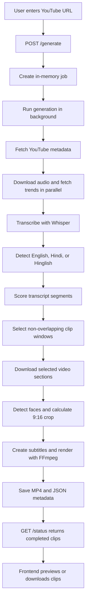

# ShortAI

ShortAI turns a long YouTube video into a set of short, vertical MP4 clips. It downloads the source audio, transcribes it, scores transcript segments for short-form potential, selects non-overlapping windows, downloads only those video sections, tracks faces, crops to 9:16, burns in captions, and exposes the finished clips through a FastAPI API and browser interface.

## Features

- YouTube URL input with configurable clip count and duration
- English, Hindi, and Hinglish transcript analysis
- CPU-friendly transcription with `faster-whisper` and an OpenAI Whisper fallback
- Hook scoring enriched with Google Trends and optional RapidAPI sources
- Partial video downloads rather than storing the entire source video
- OpenCV face detection for subject-aware 9:16 cropping
- FFmpeg rendering with burned-in subtitles
- Background generation jobs with live progress polling
- Preview and MP4 download interface

Direct file upload and platform-specific rendering presets are visible in the interface but are not implemented yet.

## Technology stack

| Layer | Technology |
| --- | --- |
| Frontend | HTML5, CSS3, vanilla JavaScript ES modules |
| API | Python, FastAPI, Pydantic, Uvicorn |
| Transcription | faster-whisper; OpenAI Whisper fallback |
| Media | yt-dlp, FFmpeg/FFprobe, OpenCV, NumPy |
| Language/trends | langdetect, pytrends, Requests, optional RapidAPI |
| Storage | Local audio, MP4, SRT, and JSON files |

## Project structure

```text
shortsGenerator/
├── frontend/
│   ├── index.html                 # Semantic page markup
│   └── assets/
│       ├── css/
│       │   └── styles.css         # Design system and responsive styles
│       └── js/
│           ├── config.js          # Browser runtime configuration
│           ├── api.js             # API client
│           ├── ui.js              # Shared DOM/UI helpers
│           ├── clips.js           # Clip cards and preview modal
│           └── app.js             # Event binding and job workflow
├── backend/
│   ├── app/
│   │   ├── api/
│   │   │   └── routes.py          # HTTP endpoints
│   │   ├── core/
│   │   │   └── config.py          # Paths and environment settings
│   │   ├── models/
│   │   │   └── jobs.py            # Request/response schemas
│   │   ├── services/
│   │   │   └── job_service.py     # Job state and orchestration
│   │   ├── processing/
│   │   │   └── engine.py          # Media/AI generation pipeline
│   │   └── main.py                # FastAPI application factory
│   ├── downloads/                 # Temporary source audio/sections (ignored)
│   ├── outputs/                   # Generated clips and metadata (ignored)
│   ├── .env.example
│   └── requirements.txt
├── .gitignore
└── README.md
```

The processing engine remains one cohesive domain module because its transcription timestamps, crop filters, subtitle generation, and render commands share one pipeline. HTTP, validation, configuration, and job state no longer live inside it.

## Application flow



While the background task runs, the frontend calls `GET /status/{job_id}` every two seconds and updates the progress interface.

## Prerequisites

- Python 3.10 or newer
- FFmpeg and FFprobe available on `PATH`
- Internet access for YouTube downloads, model downloads, and trend requests

Confirm FFmpeg is installed:

```powershell
ffmpeg -version
ffprobe -version
```

## Installation

From the project root in PowerShell:

```powershell
python -m venv .venv
.\.venv\Scripts\Activate.ps1
python -m pip install --upgrade pip
pip install -r backend\requirements.txt
Copy-Item backend\.env.example backend\.env
```

`RAPIDAPI_KEY` is optional. Without it, Instagram and X/Twitter trend enrichment is skipped and the engine uses Google Trends plus its built-in vocabulary.

## Run the application

Start the API from the project root:

```powershell
uvicorn app.main:app --reload --app-dir backend
```

Then open:

- Application: <http://localhost:8000/app/>
- Interactive API documentation: <http://localhost:8000/docs>
- Health check: <http://localhost:8000/health>

The frontend defaults to `http://localhost:8000`. To point it at another API before `app.js` loads, set `window.SHORTAI_API_URL` in the hosting page or change `frontend/assets/js/config.js`.

## API

### Start a job

```http
POST /generate
Content-Type: application/json

{
  "url": "https://www.youtube.com/watch?v=VIDEO_ID",
  "platform": "youtube_shorts",
  "num_clips": 3,
  "clip_duration": 30
}
```

The response contains a short `job_id`. Generation continues in a background task.

### Check progress

```http
GET /status/{job_id}
```

Status moves through `queued`, `processing`, and then `done` or `error`.

### Retrieve a clip

```http
GET /clips/{filename}
```

### Remove job state

```http
DELETE /jobs/{job_id}
```

Deleting a job removes only its in-memory status. It does not delete generated media.

## Configuration

| Variable | Required | Purpose |
| --- | --- | --- |
| `RAPIDAPI_KEY` | No | Enables optional Instagram and X/Twitter trend requests |
| `SHORTAI_ALLOWED_ORIGINS` | No | Comma-separated CORS origins; defaults to `*` |

Whisper model size, default clip settings, face sampling interval, and output encoding settings are currently defined near the top of `backend/app/processing/engine.py`.

## Generated data

- Temporary downloads are written to `backend/downloads/`.
- Rendered clips and transcript metadata are written to `backend/outputs/`.
- Both directories are excluded from Git.
- Job status is kept in process memory, so restarting the API clears job records but leaves output files in place.

## Current limitations

- Only YouTube URLs are accepted by the API.
- Direct uploads are not connected to a backend endpoint.
- The platform field is accepted but does not yet alter render presets.
- Jobs are in-memory and are not suitable for multiple API workers.
- CPU transcription and video rendering can be slow on long sources.
- This local prototype has no authentication, rate limiting, database, queue, or cloud storage.

For production use, move jobs to Redis or a database, run rendering in a worker queue, store media in object storage, restrict CORS, validate URLs more strictly, and add authentication and cleanup policies.
