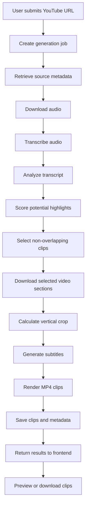

# ShortAI

ShortAI is a project to turn long YouTube videos into short, vertical clips suitable for platforms such as YouTube Shorts, Instagram Reels, and TikTok.

The planned workflow includes audio transcription, highlight selection, subject-aware cropping, caption generation, and MP4 rendering.

The repository currently contains a React, TypeScript, and Vite frontend foundation and a FastAPI backend foundation with a health-check endpoint. The complete video-processing pipeline and end-to-end application workflow are not yet implemented or verified.

## Current Implementation Status

### Frontend

- **Framework:** React
- **Language:** TypeScript
- **Build tool:** Vite
- **Verification:** Production build succeeds with `npm run build`.
- **Status:** Frontend foundation implemented. Video-generation functionality and backend integration are not yet implemented or verified.

### Backend

- **Framework:** FastAPI
- **Server:** Uvicorn
- **Configuration:** The allowed frontend origin is configurable through the `FRONTEND_ORIGIN` environment variable.
- **Health endpoint:** `GET /health`
- **API documentation:** Available at `/docs` when the server is running.
- **Testing:** The health endpoint test passes with pytest.
- **Status:** Backend foundation implemented and verified.

### Planned Work

1. Implement video-generation API endpoints and request/response schemas.
2. Add Redis-backed background job processing.
3. Implement audio transcription and highlight selection.
4. Build the video download, cropping, subtitle, and rendering pipeline.
5. Integrate the frontend with the backend.
6. Add job progress tracking, clip previews, and MP4 downloads.

## Planned Features

The following features describe the intended direction of ShortAI and are not yet implemented or verified as a complete workflow.

- Accept a YouTube URL and configurable clip count and duration.
- Transcribe audio using `faster-whisper` or an alternative Whisper implementation.
- Analyze English, Hindi, and Hinglish transcripts.
- Score transcript segments for short-form potential.
- Select non-overlapping clip windows.
- Download only the selected video sections where technically supported.
- Detect faces and calculate subject-aware 9:16 crops.
- Render vertical MP4 clips with burned-in subtitles using FFmpeg.
- Run generation jobs in the background and report progress.
- Preview and download generated clips through a browser interface.
- Explore optional trend enrichment to improve highlight selection.

Direct file uploads and platform-specific rendering presets are not part of the currently verified implementation.

## Technology Stack

| Layer | Technology | Status |
|---|---|---|
| Frontend | React, TypeScript, Vite | Foundation implemented |
| API | Python, FastAPI, Uvicorn | Foundation implemented |
| Testing | pytest, FastAPI test client | Health endpoint tested |
| Background jobs | Redis, RQ | Planned |
| Transcription | faster-whisper or Whisper | Planned |
| Video downloading | yt-dlp | Planned |
| Media processing | FFmpeg, FFprobe, OpenCV, NumPy | Planned |
| Language detection | langdetect | Planned |
| Trend enrichment | pytrends, Requests, optional RapidAPI | Planned |
| Storage | Local media and metadata files | Planned |

The planned technologies may change as the architecture develops.

## Project Structure

The current repository structure includes the following components. The frontend and backend may contain additional configuration, styling, and tooling files.

```text
shortsGenerator/
├── frontend/
│   ├── index.html
│   ├── package.json
│   ├── package-lock.json
│   ├── tsconfig.json
│   ├── vite.config.ts
│   └── src/
│       ├── App.tsx
│       ├── main.tsx
│       └── ...
├── backend/
│   ├── app/
│   │   ├── __init__.py
│   │   ├── config.py
│   │   └── main.py
│   ├── tests/
│   │   └── test_health.py
│   └── requirements.txt
├── .gitignore
└── README.md
```

Generated build files, virtual environments, dependencies, and other local artifacts should not be committed unless explicitly required.

## Prerequisites

- Python 3.10 or newer.
- Node.js and npm.
- Git.

FFmpeg, FFprobe, and internet access for source-media and model downloads will be required when the video-processing pipeline is implemented.

## Installation

Clone the repository and move into the project directory:

```bash
git clone <your-repository-url>
cd shortsGenerator
```

Replace `<your-repository-url>` with the URL of your Git repository.

### Set Up the Backend

From the repository root, run:

```bash
cd backend
python -m venv .venv
source .venv/Scripts/activate
python -m pip install --upgrade pip
python -m pip install -r requirements.txt
```

The activation command above is for Git Bash on Windows. On macOS or Linux, use:

```bash
source .venv/bin/activate
```

### Set Up the Frontend

Open a second terminal from the repository root:

```bash
cd frontend
npm install
```

## Run the Application

The frontend and backend currently run independently. The complete video-generation workflow is not yet integrated.

### Start the Backend

From the repository root:

```bash
cd backend
```

Activate the virtual environment if it is not already active, then start the API:

```bash
uvicorn app.main:app --reload
```

The backend is available at:

- **API base URL:** `http://127.0.0.1:8000`
- **Health check:** `http://127.0.0.1:8000/health`
- **Interactive API documentation:** `http://127.0.0.1:8000/docs`

The health endpoint returns:

```json
{
  "status": "ok"
}
```

### Start the Frontend

In a second terminal:

```bash
cd frontend
npm run dev
```

Open the local URL printed by Vite, typically `http://localhost:5173`.

The frontend is currently a development foundation. Video generation, job tracking, and clip downloads are not yet connected to the backend.

### Build the Frontend

From the `frontend` directory:

```bash
npm run build
```

This creates a production build using Vite.

## API

### Implemented Endpoints

| Method | Endpoint | Description |
|---|---|---|
| `GET` | `/health` | Returns the API health status. |

### Planned Endpoints

The following endpoints are potential parts of the future API and are not implemented yet:

| Method | Endpoint | Intended purpose |
|---|---|---|
| `POST` | `/generate` | Start a clip-generation job. |
| `GET` | `/status/{job_id}` | Retrieve job status and progress. |
| `GET` | `/clips/{filename}` | Retrieve a generated clip. |
| `DELETE` | `/jobs/{job_id}` | Remove a job record. |

The final routes and response schemas will be documented once implemented and tested.

## Configuration

| Variable | Required | Purpose |
|---|---|---|
| `FRONTEND_ORIGIN` | No | Specifies the allowed frontend origin for CORS. Defaults to `http://localhost:5173`. |

For example, in Git Bash:

```bash
export FRONTEND_ORIGIN="http://localhost:5173"
```

Set the variable in the terminal before starting Uvicorn. The current backend uses this setting to configure its allowed frontend origin.

Additional configuration for transcription models, media processing, trend sources, and output storage will be introduced as those features are implemented.

## Planned Application Flow

The following diagram describes the intended workflow, not the current implementation.



## Testing

Run the backend health endpoint test from the `backend` directory with the virtual environment activated:

```bash
python -m pytest tests/test_health.py -v
```

The test verifies that `GET /health` returns HTTP `200` and the expected JSON response.

## Current Limitations

- Only the backend health endpoint is currently implemented.
- The frontend and backend are not yet connected into a complete application workflow.
- YouTube downloading, transcription, highlight scoring, and video rendering are not yet implemented or verified.
- Redis-backed background jobs and persistent job storage are not yet implemented.
- Generated clips, progress polling, and download endpoints are not yet available.
- Authentication, rate limiting, production deployment, and cloud storage have not yet been implemented.

## Development Roadmap

- [x] Initialize the React, TypeScript, and Vite frontend.
- [x] Initialize the FastAPI backend.
- [x] Add a health-check endpoint.
- [x] Add a health endpoint test.
- [ ] Define video-generation request and response schemas.
- [ ] Implement job creation and status tracking.
- [ ] Add Redis-backed background workers.
- [ ] Implement transcription and highlight selection.
- [ ] Implement vertical clip rendering and subtitle generation.
- [ ] Integrate the frontend with the backend.
- [ ] Add end-to-end tests and deployment configuration.

## Contributing

Contributions and suggestions are welcome. Keep documentation aligned with the code: mark features as implemented only after they exist and have been tested.

## License

A license has not yet been specified. Add a `LICENSE` file before presenting the project as open source under a particular license.
